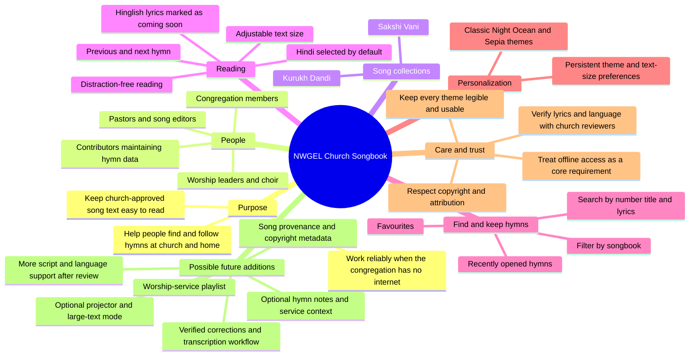

# NWGEL Church Songbook: project mind map

## Purpose and people

## How the app is organized

- **Runtime:** React Native with Expo SDK 51 and Expo Router. The entry point is `expo-router/entry`; the root navigation and shared providers are in `app/_layout.tsx`.
- **Screens:** `app/(tabs)/` contains Home, Search, Favourites, and Settings. `app/books/[book].tsx` lists a collection; `app/song/[id].tsx` is the hymn reader.
- **Hymn source of truth:** `src/data/kurukhDandi.json` and `src/data/sakshiVani.json`. A song has a unique `id`, a `bookId`, a collection-specific `number`, a `title`, optional metadata, and lyric `sections`. Sections can be `verse`, `chorus`, `refrain`, or `bridge`.
- **Offline database:** `src/database/db.ts` imports both bundled JSON collections and synchronizes them into the local SQLite database. Search, collection lists, hymn details, and adjacent-song navigation use this database. When editing songs, keep their IDs unique and the JSON valid.
- **Shared user state:** `src/context/AppPreferencesContext.tsx` provides the theme and reading-size preferences; `src/context/FavouritesContext.tsx` stores favourites and recent hymn IDs locally.
- **Design system:** `src/constants/theme.ts` defines the semantic color palettes. Screens and reusable UI in `src/components/` should use these tokens rather than one-off colors wherever practical.
- **Brand artwork:** `assets/icon.png`, `assets/adaptive-icon.png`, and `assets/splash.png` supply app and launch artwork. Expo Go may show its own launch screen; use a development or standalone build to evaluate the native splash.

## UX and content guardrails

1. The hymn reader starts in Hindi. Its visible lyric choices are Hindi and Hinglish; do not restore an English choice without a deliberate product decision.
2. Hinglish lyrics are not present yet. Keep the clear “coming soon” state until reviewed transliterations are available; do not transliterate worship text automatically.
3. Worship lyrics must be accurate. Have a fluent, church-authorized reviewer verify spelling, verse order, chorus/refrain labeling, and attribution before publishing changes.
4. Keep reading controls easy to reach during a service: clear song number, readable lyric size, predictable previous/next actions, and a distraction-free option.
5. Preserve local access to bundled hymns. Core reading and searching should not depend on sign-in, a network connection, or a remote service.
6. Design for long sessions and varied ages: generous text and touch targets, calm visual hierarchy, legible disabled states, and no meaning conveyed by color alone.
7. Respect the source and rights for every hymn. Confirm permission and attribution before adding or distributing lyrics.

## Color and accessibility rules

- Classic is the default: deep church green, warm ivory, restrained gold, and white reading cards.
- Night uses a genuinely dark canvas and raised card surfaces, with warm white text and bright gold accents.
- Ocean and Sepia use their own matching surfaces and accents rather than retaining green-and-gold components that clash.
- Use `primaryText` and `secondaryText` on reading surfaces. Use `mutedGold` where gold needs to remain readable on both light and dark surfaces; use `mutedGoldLight` for decoration on dark brand backgrounds.
- `white` is a surface token and becomes a dark card surface in Night mode; use `onBrand` for text and icons on selected or branded controls.
- Never put a dark green icon on a similarly dark background. Check the foreground/background pairing when changing palettes, including tab icons, selected states, book cards, and controls.
- Target WCAG AA contrast for normal-size text (4.5:1) and large text (3:1). Recheck contrast after any palette change; a swatch alone does not demonstrate readability.

## Church-focused roadmap (ideas, not implemented promises)

### First: trust and usefulness

- Establish a church-approved proofreading and correction process, with reviewer and revision notes.
- Add hymn-source, attribution, and permission metadata and show it where appropriate.
- Let a worship leader build and reorder a simple local service playlist; keep the playlist available offline.
- Consider “recently opened” on Home for quickly returning to a hymn during rehearsal or worship.

### Then: worship presentation

- Add an optional large-text/projector view with minimal chrome, high contrast, and a clear way to keep the reader in sync.
- Allow the reader to show one verse or chorus at a time for congregational projection, while retaining full-song scrolling on personal devices.
- Only add lyrics in Romanized Hindi, Kurukh, or other languages after a fluent reviewer confirms the transcription and the church approves the wording.

### Before any shared or online features

- Agree who can publish song changes and how a congregation receives reviewed updates.
- Keep personal data optional; the core songbook should remain usable without accounts.
- Define copyright, consent, privacy, and moderation requirements before adding uploads, public sharing, or analytics.

## Developer commands

- `npm install` — install the dependencies recorded in the lockfile.
- `npm start` — start the Expo development server.
- `npm run android` — start the app for an Android emulator or connected device.
- `npm run type-check` — check TypeScript.
- `npm run lint` — run ESLint.
- `npx expo export --platform android` — check that the Android JavaScript bundle exports.
