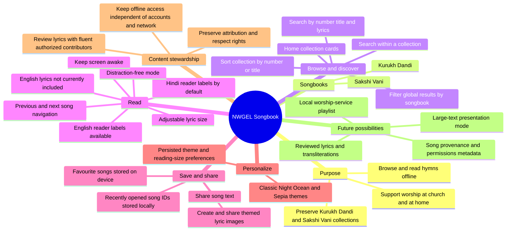

# NWGEL Songbook — project mind map

## Product overview

## Current architecture

- **Runtime and navigation:** React Native, Expo SDK 51, TypeScript, and Expo
  Router. `expo-router/entry` starts the app; `app/_layout.tsx` sets up the
  root stack and shared providers.
- **Screens:** `app/(tabs)/` contains Home, Search, Favourites, and Settings.
  `app/books/[book].tsx` displays a collection; `app/song/[id].tsx` is the
  reader and sharing interface.
- **Bundled song data:** `src/data/kurukhDandi.json` and
  `src/data/sakshiVani.json`. A song has a globally unique `id`, a `bookId`, a
  number within its book, a title, optional category, and lyric sections.
  Supported section types are `verse`, `chorus`, `refrain`, and `bridge`.
- **Local database:** `src/database/db.ts` synchronizes bundled songs into
  SQLite when the database opens. Collection lists, song details, adjacent
  navigation, and search use this local database. Search indexes the song
  number, title, category, and section text.
- **Local preferences and history:** `src/context/AppPreferencesContext.tsx`
  manages theme, reading size, and temporary distraction-free state.
  `src/context/FavouritesContext.tsx` persists favourites and up to ten
  recently opened song IDs with AsyncStorage. Recent IDs are tracked locally;
  there is no dedicated recent-songs screen.
- **Reusable UI and design tokens:** `src/components/` contains common
  components; `src/constants/theme.ts` defines the Classic, Night, Ocean, and
  Sepia palettes.
- **App artwork:** `assets/` contains the app icon and splash assets.

## Content contribution workflow

1. Edit the appropriate bundled JSON file and keep its array valid.
2. Use a unique song ID and the correct `bookId`; keep IDs stable between
   revisions so local favourites and recent-song references remain valid.
3. Use supported section types and preserve the intended verse, chorus,
   refrain, and bridge order.
4. Have a fluent, authorized reviewer verify spelling, lyrics, and structure.
5. Confirm permission and attribution before publishing or distributing text.

The database synchronizes bundled content when it opens. Do not instruct users
to clear local app data to load ordinary song updates.

## UX and content guardrails

- Keep core hymn browsing, search, and reading available offline without
  accounts or remote services.
- Do not imply that English lyrics or Hinglish transliterations are included;
  the reader's English option changes interface labels, not hymn content.
- Treat hymn accuracy and rights as release requirements. Do not automatically
  transliterate worship text.
- Keep reader controls legible and usable during long services, and verify
  contrast and touch targets when changing the interface or theme palettes.
- The project is independently maintained and is not an official church
  publication. Rights and attribution remain with the respective owners.

## Roadmap ideas (not implemented features)

- Build a local playlist for a worship service.
- Explore an optional large-text presentation mode.
- Add reviewed lyrics or transliterations only after contributor and rights
  review.
- Record hymn sources, permissions, and attribution in structured metadata.
- Define privacy, consent, and publishing responsibilities before adding
  online features or user-submitted content.

## Developer commands

- `npm install` — install dependencies from the lockfile.
- `npm start` — start the Expo development server.
- `npm run android` — run on an Android emulator or device.
- `npm run ios` — run on an iOS simulator or device (macOS and Xcode required).
- `npm run web` — start the Expo web target.
- `npm run type-check` — run the TypeScript check.
- `npm run lint` — run ESLint.
